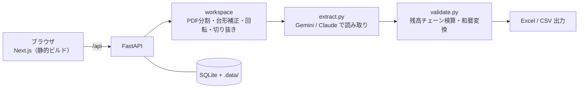

# 通帳スキャン（tsucho-scan）

日本の銀行通帳の**画像・PDFを読み取り、残高チェーンで全行を検算して Excel / CSV に書き出す** Webアプリです。
機械が自信を持てなかった行だけを黄色で示すので、人が確認するのは数行だけで済みます。

> **English summary** — A web app that reads photos/PDFs of Japanese bank passbooks (通帳) with a vision AI model, verifies every row against the running balance, flags only the uncertain cells, and exports Excel/CSV. Python (FastAPI) + Next.js, deployed as a single Docker service.

| | |
|---|---|
| 紹介ページ | https://tsucho-scan.vercel.app |
| アプリ | https://tsucho-scan.onrender.com（「サンプル通帳で試す」を使えば、AIを呼ばずに動作を確認できます） |


*左：通帳の面の一覧 ／ 中央：通帳の写真 ／ 右：読み取り結果。表の行を選ぶと、写真の同じ行に赤い帯が付きます。*

## 解決したい課題

通帳は銀行ごとに列の並び・記号・印字のルールが違い、AIやOCRで読み取っても「数字が合っているか」を人がすべて目で確かめる必要があります。

通帳の各行には必ず次の関係が成り立ちます。

```
前の残高 − お支払金額 ＋ お預り金額 ＝ その行の残高
```

この関係（残高チェーン）を全行で機械的に確かめ、**合わない行だけを人に示す**ことで、確認の手間を減らします。

## 主な機能

- **取り込み**：画像（PNG / JPG / WEBP）とPDFに対応。複数ページのPDFは1面ずつ自動で分割し、SHA-256で同じ画像の重複を防ぎます
- **画像補正**：台形補正（四隅をドラッグ）、切り抜き、回転、明るさ・コントラスト。1段階の取り消しができます
- **AIによる読み取り**：Google Gemini と Anthropic Claude を環境変数で切り替え可能
- **残高チェーン検算**：全行を検算し、和暦（令和・平成など）は西暦に変換
- **二重チェック**：出金 / 入金の列の取り違えを検出して自動修正し、修正した箇所は緑で表示
- **確認しやすい画面**：3ペイン構成。セルを直接編集すると残高が自動で再計算され、Ctrl+Z や矢印キー移動に対応
- **出力**：Excel（検算の数式・集計レポート付き）と CSV（BOM付きUTF-8）
- **多言語UI**：日本語 / ベトナム語 / 英語
- **アカウント**：ユーザーごとにデータを分離

## 仕組み



読み取りの実行はバックグラウンドのスレッドで行い、進捗は Server-Sent Events（SSE）で画面に流します。
CLI と Web は同じ `core.scan()` を呼ぶため、ロジックは1か所にまとまっています。

## 技術構成

| 領域 | 使用技術 |
|---|---|
| バックエンド | Python 3.12 / FastAPI / uvicorn / SQLite |
| 画像・PDF・Excel | Pillow / NumPy / PyMuPDF / pypdf / openpyxl |
| フロントエンド | Next.js 16 / React 19 / TypeScript / Tailwind CSS v4 |
| AI | Google Gemini API / Anthropic Claude API（vision） |
| 配布 | Docker（Web と API を1サービスに統合）／ Render |
| テスト | pytest |

## ディレクトリ構成

| パス | 役割 |
|---|---|
| `core.py` | `scan()`：CLI と Web が共用する中心処理 |
| `extract.py` | AI呼び出し、JSON抽出、内容ハッシュによるキャッシュ |
| `validate.py` | 残高チェーン検算、和暦 → 西暦変換 |
| `export.py` | Excel出力（検算の数式つき） |
| `eval.py` | 手書きの正解ファイルと比べて精度を測る |
| `main.py` | コマンドライン版 |
| `api/` | FastAPI（認証、作業領域、ジョブ、行検出、エクスポートなど） |
| `web/` | Next.js のフロントエンド |
| `prompts/extract_prompt.txt` | 読み取り用のプロンプト |
| `tests/` | pytest のテスト |
| `docs/` | 設計・手順メモ（ベトナム語） |

## セットアップ（ローカル）

前提：Python 3.12、Node.js、Gemini または Anthropic の APIキー

```bash
git clone https://github.com/huynh2104-stack/tsucho-scan
cd tsucho-scan

# 1. Python の依存をインストール
python -m pip install -r requirements.txt

# 2. .env を作って APIキーを記入（Windows は copy、Mac/Linux は cp）
copy .env.example .env
```

```bash
# ターミナル1：API（http://localhost:8000）
python -m uvicorn api.main:app --reload --port 8000

# ターミナル2：Web（http://localhost:3000）
cd web
npm install
npm run dev
```

動作確認は `http://localhost:8000/api/health` が `{"ok":true}` を返せばOKです。

コマンドライン版：

```bash
python main.py input/ファイル名.jpg -o output/結果.xlsx
```

### 環境変数

| 変数 | 内容 |
|---|---|
| `GEMINI_API_KEY` / `ANTHROPIC_API_KEY` | 使うAIに応じて設定 |
| `EXTRACT_MODEL` | 使うモデル。未設定なら `gemini-2.5-flash`、`claude-*` なら Anthropic、`gemini-*` なら Google を呼びます |
| `TSUCHO_ORIGINS` | 許可するオリジン（CORS）。カンマ区切り |
| `TSUCHO_COOKIE_SECURE` | HTTPS 環境で `1` を設定 |
| `TSUCHO_TRUST_PROXY` | リバースプロキシの背後で実IPを使う場合に `1` を設定 |

### デプロイ

`Dockerfile` が Web（静的ビルド）と API を**1つのサービス**にまとめます。同一オリジンになるので CORS の設定は不要です。
画像・Excel・アカウントDBは `/app/.data` に保存されるため、デプロイ先では永続ディスクをここにマウントします。
Render への手順は [`docs/TRIEN_KHAI.md`](docs/TRIEN_KHAI.md)（ベトナム語）を参照してください。

## 精度と限界

「100%」とは言いません。手元の通帳で測った数字は次のとおりです（評価に使った通帳は少数のため参考値です）。

| 項目 | 精度 | 備考 |
|---|---|---|
| 金額・残高 | 93〜100% | 残高チェーンで裏づけが取れます |
| 振込先のカナ | 60〜95% | 検算では守れないため、目での確認が必要です |
| 1ページの処理時間 | 数秒〜十数秒 | |

モデルごとの比較（実測・少数ページ）：

| モデル | 費用 / ページ | 金額・残高 | 摘要の文字 |
|---|---|---|---|
| `gemini-2.5-flash`（既定） | 約 $0.006（無料枠あり） | 検算で裏づけ | カナの誤りがある |
| `claude-sonnet-5` | 約 $0.014 | 評価セット内で全て正解 | 良好 |

同じ画像の読み取り結果は内容ハッシュでキャッシュされ、再実行時は費用がかかりません。

**検算で検出できないこと**：行がまるごと抜けた場合と、振込先のカナの読み違い。この2点は目で確認する必要があります。

## セキュリティとプライバシー

- パスワードは `hashlib.scrypt` で保存。ログインのセッションはランダムなトークンを `HttpOnly` Cookie に入れ、DBにはそのトークンの SHA-256 ハッシュだけを保存します
- ログイン失敗はメールアドレス単位（5回）と IP 単位（20回）で数え、15分ロックします
- 通帳の画像は読み取りのためにサーバーに保存され、AIプロバイダ（Google / Anthropic）に送信されます
- ユーザーごとにデータを分離。`.env`、アップロード画像、生成ファイル、DB は `.gitignore` で除外しています
- テストに使っている口座番号・名義はダミーの値です。デモ（サンプル通帳）のデータは、利用の許可を得たものを使っています
- **未実装**：パスワード再設定、メールアドレスの確認（外部公開の前に必要）

## テスト

```bash
python -m pytest
```

検算、和暦変換、認証、行検出、台形補正、Excel出力などのテスト関数が合計155本あります。

※ `tests/test_scan_errors.py` は `GEMINI_API_KEY` が設定されている前提です（ダミーの値でも動きます）。

## 開発の経緯

AIコーディングツール（Claude Code）を活用して開発しています。コミット履歴から見た流れは次のとおりです。

| 日付（2026年） | 内容 |
|---|---|
| 7/10 | Phase 1：通帳を Excel に変換するコマンドライン版 |
| 7/18 | Phase 2：複数のAIプロバイダ（Gemini / Claude）に対応、二重チェック |
| 7/28 | Phase 3：PDFのページ分割、評価スクリプト（`eval.py`）で精度を数値化 |
| 7/30 | Web アプリ化（3ペイン画面） |
| 7/31 | ログイン、ユーザーごとのデータ分離、行検出（`rowmap`）の書き直し |
| 8/3 | Docker で Web と API を1サービスに統合し、デプロイ |
| 8/4 | パスワード総当たり対策、7ステップの操作ガイド |

## 既知の制限と今後

- 勘定科目の自動仕訳や月次レポートの作成、会計ソフトとの直接連携はありません（Excel / CSV を取り込んで使います）
- パスワード再設定とメール確認が未実装です
- `docs/` の設計メモはベトナム語です

## 作者

NGUYEN DAN HUYNH（グエン ダン フイン） — GitHub: [@huynh2104-stack](https://github.com/huynh2104-stack)
